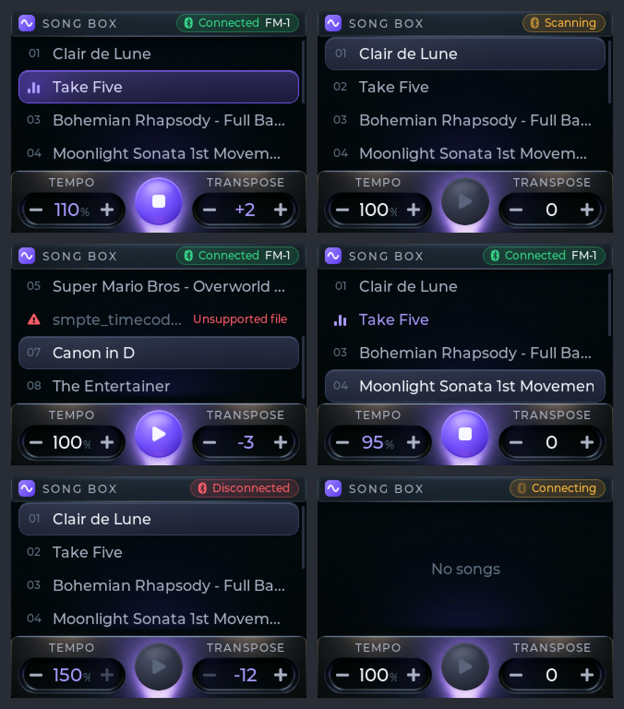

# FM-1 Song Box

A small ESP32-S3 touchscreen box that stores MIDI songs and plays them on an
**M-VAVE FM-1** synth over **Bluetooth LE MIDI**. The box makes no sound itself;
the FM-1 is the sound source. It also has a **Lo-fi Generator** that composes
endless lo-fi hip hop live on the ESP32.



## Features

- Plays Standard MIDI Files (type 0 and 1) from internal flash, every event on its
  original channel, so multi-track files play with all their instruments
- Touch UI: song list, Play/Stop, tempo 50-150 %, transpose -12..+12 (drums on
  channel 10 are never transposed), BLE status. Tempo and transpose change live
- Finds and connects to the FM-1 by itself, remembers it, reconnects after a drop
- Sends All Sound Off / Reset All Controllers / All Notes Off on every channel on
  Stop, song end and disconnect, so nothing hangs
- **Lo-fi Generator** (first row in the list): see below

## Lo-fi Generator

An endless chain of complete pieces composed on the ESP32-S3 (`main/lofi_gen.c`).
Each piece is about 3 minutes with a real form: intro, groove, hook, groove, hook,
break, a final hook lifted to a new key, and an outro that slows down to the end.
Then the next piece starts with its own key, tempo (72-86 BPM), progressions,
melody and lead sound. Parts: Rhodes, bass, string pad, drums and a lead
(electric piano, flute or vibes).

Every piece has a number from 0 to 9999, and the same number always gives the same
piece. The row shows the number while it plays (e.g. "Lo-fi Generator #4821").
Play starts a random piece; holding Play while stopped replays the piece shown.

It is rule-based algorithmic composition, not machine learning: there is no
model or training data, and it needs no internet connection. Chords, rhythms and
melody shapes are tables written in the code; a seeded random generator only
chooses among them and voice-leads the result.

## Hardware

| Part | Notes |
|---|---|
| LCDWiki **ES3C28P** (2.8" ESP32-S3, N16R8) | ILI9341 320x240 SPI + FT6336G touch. Same hardware as the Freenove FNK0104 |
| **M-VAVE FM-1** with the **CTL-1** firmware | Bluetooth build `ctl-1.0.fwsc` from [charlesvestal/fm1-ctl](https://github.com/charlesvestal/fm1-ctl) |

CTL-1 passes incoming MIDI to a General MIDI engine (Sonivox EAS) on all 16
channels, which is what makes multi-channel playback possible. The stock FM-1
firmware does not do this.

### FM-1 setup (CTL-1)

1. Flash the Bluetooth build of CTL-1 (`ctl-1.0.fwsc`, not `ctl-usb-1.0.fwsc`).
2. Sound page: EDIT, Knob 1 **Sound On**, Knob 2 **MIDI in: Plays**.
3. Bluetooth page (GLO for Setup, then turn SELECT twice): KNOB 4 turns Bluetooth on.
   It advertises as "FM-1".
4. Disconnect phones or computers from the FM-1; it accepts one BLE central at a time.

See the [CTL-1 manual](https://charlesvestal.github.io/fm1-ctl/manual/) for details.

## Build and flash

ESP-IDF **v5.5.2**, target `esp32s3`. Component versions are pinned in
`main/idf_component.yml` and `dependencies.lock`.

```sh
idf.py build
idf.py -p <PORT> flash             # firmware only; songs on the board are kept
idf.py -p <PORT> storage-flash     # write the songs/ folder to the FAT partition
```

`storage-flash` replaces all songs on the board with the contents of `songs/`.

## Songs

`songs/` holds original example songs in nine styles plus Happy Birthday (public
domain). They are generated by the Python scripts in `tools/songs/`
(`python tools/songs/make_all.py` builds and checks them all). To add your own,
put `.mid` files in `songs/` and run `storage-flash`.

Planned, not written yet: a Wi-Fi SoftAP with a web page for uploading and
deleting songs from a phone.

## Repository layout

```
main/            firmware (ESP-IDF component)
  ble_midi.c     BLE MIDI central: scan, connect, packet framing, reconnect
  smf.c          Standard MIDI File parser -> compact event array in PSRAM
  player.c       timed event player (esp_timer), tempo map, transpose
  lofi_gen.c     the lo-fi composer (plain C, no ESP-IDF calls)
  display.c, touch.c, gui.c   ILI9341 + FT6336G + LVGL 9 (esp_lvgl_port)
  ui/            screen UI, design tokens, generated image assets
tools/songs/     MIDI song generators and a checker
tools/ui_assets/ draws the UI bitmaps and converts them to LVGL C arrays
tools/ui_preview/ host build of the real UI code, renders screenshots to docs/ui/
assets/          UI source images
```

## Credits

- [CTL-1](https://github.com/charlesvestal/fm1-ctl) FM-1 firmware by Charles Vestal
- [LVGL](https://lvgl.io) and Espressif's ESP-IDF components
- The skin background art (`assets/skin/skin_bg_art.jpg`) was made with Google's
  image generator; the brief is in `assets/skin/gemini_prompt.txt`

## License

MIT, see [LICENSE](LICENSE).
